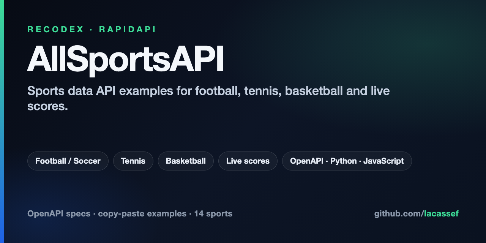

<p align="center">
  
</p>

# AllSportsAPI — Sports data API examples (football, tennis, basketball, live scores)

OpenAPI specs and copy-paste **Python** / **JavaScript** examples for Recodex APIs. AllSportsAPI covers live scores, fixtures, standings, odds, lineups, players, and shotmaps for football/soccer, tennis, basketball, ice hockey, cricket, esports, and more. The same repo documents AllScores, LivescoresAPI, and SKAlpha.

[](LICENSE)
[](allsportsapi/Examples/)
[](allsportsapi/Examples/)
[](allsportsapi/openapi/)
[](https://rapidapi.com/fluis.lacasse/api/allsportsapi2)
[](https://github.com/lacassef/recodex-api-examples)

## What's in this repository

| Product | What you get | Start here |
|---------|--------------|------------|
| **AllSportsAPI** | Multi-sport live and historical data — scores, fixtures, standings, odds, players, media, shotmaps | [allsportsapi/README.md](allsportsapi/README.md) |
| **AllScores** | Scores, fixtures, standings, lineups, athletes, odds, and news on `/api/allscores` | [allscores/README.md](allscores/README.md) |
| **LivescoresAPI** | Scoreboards, feeds, tournaments, matches, rankings, news, and persisted queries on `/api/livescores` | [livescores/README.md](livescores/README.md) |
| **SKAlpha** | Quotes, prices, news, symbols, screeners, and fundamentals on `/api/skalpha` | [skalpha/README.md](skalpha/README.md) |

Subscribe on [RapidAPI](https://rapidapi.com/fluis.lacasse) (every sport API plus the All Sports bundle) or [API.market](https://api.market/store/recodex/allsportsapi) (complete All Sports bundle).

## AllSportsAPI sports

Same authentication, response shapes, and endpoint structure across every sport. Learn one API and you know them all.

| Sport | RapidAPI | Host (`X-RapidAPI-Host`) |
|-------|----------|--------------------------|
| **All Sports** (bundle) | [allsportsapi2](https://rapidapi.com/fluis.lacasse/api/allsportsapi2) | `allsportsapi2.p.rapidapi.com` |
| Football / Soccer | [footapi7](https://rapidapi.com/fluis.lacasse/api/footapi7/) | `footapi7.p.rapidapi.com` |
| Tennis | [tennisapi1](https://rapidapi.com/fluis.lacasse/api/tennisapi1/) | `tennisapi1.p.rapidapi.com` |
| Basketball | [basketapi1](https://rapidapi.com/fluis.lacasse/api/basketapi1/) | `basketapi1.p.rapidapi.com` |
| Ice Hockey | [icehockeyapi](https://rapidapi.com/fluis.lacasse/api/icehockeyapi/) | `icehockeyapi.p.rapidapi.com` |
| American Football | [americanfootballapi](https://rapidapi.com/fluis.lacasse/api/americanfootballapi/) | `americanfootballapi.p.rapidapi.com` |
| Baseball | [baseballapi](https://rapidapi.com/fluis.lacasse/api/baseballapi/) | `baseballapi.p.rapidapi.com` |
| Cricket | [cricketapi21](https://rapidapi.com/fluis.lacasse/api/cricketapi21/) | `cricketapi21.p.rapidapi.com` |
| Esports | [esportapi1](https://rapidapi.com/fluis.lacasse/api/esportapi1/) | `esportapi1.p.rapidapi.com` |
| Motorsport | [motorsportapi](https://rapidapi.com/fluis.lacasse/api/motorsportapi/) | `motorsportapi.p.rapidapi.com` |
| Rugby | [rugbyapi2](https://rapidapi.com/fluis.lacasse/api/rugbyapi2/) | `rugbyapi2.p.rapidapi.com` |
| Volleyball | [volleyballapi](https://rapidapi.com/fluis.lacasse/api/volleyballapi) | `volleyballapi.p.rapidapi.com` |
| Handball | [handballapi](https://rapidapi.com/fluis.lacasse/api/handballapi) | `handballapi.p.rapidapi.com` |
| MMA | [mmaapi](https://rapidapi.com/fluis.lacasse/api/mmaapi) | `mmaapi.p.rapidapi.com` |

## Other products

| Product | RapidAPI | Host (`X-RapidAPI-Host`) |
|---------|----------|--------------------------|
| **AllScores** | [allscores](https://rapidapi.com/fluis.lacasse/api/allscores) | `allscores.p.rapidapi.com` |
| **SKAlpha** | [skalpha1](https://rapidapi.com/fluis.lacasse/api/skalpha1) | `skalpha1.p.rapidapi.com` |
| **LivescoresAPI** | [livescoresapi](https://rapidapi.com/fluis.lacasse/api/livescoresapi) | `livescoresapi.p.rapidapi.com` |

Always copy the exact host from the RapidAPI **Endpoints** tab for the API you subscribed to.

## Quick start

Every request needs two headers: `X-RapidAPI-Key` (your key) and `X-RapidAPI-Host` (the sport you are calling). Keep the key on the server — never ship it in browser or mobile code.

### cURL

```bash
curl --request GET \
  --url 'https://footapi7.p.rapidapi.com/api/matches/live' \
  --header 'X-RapidAPI-Key: YOUR_API_KEY' \
  --header 'X-RapidAPI-Host: footapi7.p.rapidapi.com'
```

### Python

```python
import os, requests

url = "https://footapi7.p.rapidapi.com/api/matches/live"
headers = {
    "X-RapidAPI-Key": os.environ["RAPIDAPI_KEY"],
    "X-RapidAPI-Host": "footapi7.p.rapidapi.com",
}

resp = requests.get(url, headers=headers, timeout=15)
resp.raise_for_status()
print(len(resp.json().get("events", [])), "live matches")
```

### JavaScript

```js
const res = await fetch("https://footapi7.p.rapidapi.com/api/matches/live", {
  headers: {
    "X-RapidAPI-Key": process.env.RAPIDAPI_KEY,
    "X-RapidAPI-Host": "footapi7.p.rapidapi.com",
  },
});
const data = await res.json();
console.log(data.events?.length, "live matches");
```

Runnable clients and a server-side proxy: [allsportsapi/Examples](allsportsapi/Examples/README.md). Full authentication notes, data model, and workflows: [allsportsapi/README.md](allsportsapi/README.md).

## Examples

| Example | Python | JavaScript | What it shows |
|---------|--------|------------|---------------|
| Quickstart | [quickstart.py](allsportsapi/Examples/quickstart.py) | [quickstart.js](allsportsapi/Examples/quickstart.js) | Auth → live matches → parse events |
| Server proxy | [server_proxy_flask.py](allsportsapi/Examples/server_proxy_flask.py) | [server_proxy_express.js](allsportsapi/Examples/server_proxy_express.js) | Keep the API key off the client |
| Match clock | [match_clock.py](allsportsapi/Examples/match_clock.py) | [match_clock.js](allsportsapi/Examples/match_clock.js) | Elapsed time, added time, display clock |
| List all leagues | [list_all_leagues.py](allsportsapi/Examples/list_all_leagues.py) | [list_all_leagues.js](allsportsapi/Examples/list_all_leagues.js) | Categories → tournaments tree |
| Timezone schedule | [filter_schedule_by_timezone.py](allsportsapi/Examples/filter_schedule_by_timezone.py) | [filter_schedule_by_timezone.js](allsportsapi/Examples/filter_schedule_by_timezone.js) | Local-day filter (DST-safe) |

Sport-specific demos: [football heatmap / shotmap](allsportsapi/Footapi/), [basketball shotmap](allsportsapi/Basketapi/), [tennis cup trees](allsportsapi/Tennisapi/).

## OpenAPI specs

Import into Swagger UI, Postman, Insomnia, or a client generator.

- [All sports (full)](allsportsapi/openapi/allsports_openapi.yaml) and [simplified](allsportsapi/openapi/allsports_simplified_openapi.yaml)
- Per sport: [football](allsportsapi/openapi/football_openapi.yaml), [tennis](allsportsapi/openapi/tennis_openapi.yaml), [basketball](allsportsapi/openapi/basketball_openapi.yaml), [ice hockey](allsportsapi/openapi/ice_hockey_openapi.yaml), [cricket](allsportsapi/openapi/cricket_openapi.yaml), [esports](allsportsapi/openapi/esports_openapi.yaml), [and more](allsportsapi/openapi/README.md)
- AllScores: [allscores/openapi/allscores_openapi.yaml](allscores/openapi/allscores_openapi.yaml)
- LivescoresAPI: [livescores/openapi/livescoresapi_openapi.yaml](livescores/openapi/livescoresapi_openapi.yaml)
- SKAlpha: [skalpha/openapi/skalpha_openapi.yaml](skalpha/openapi/skalpha_openapi.yaml)

## Docs map

- [AllSportsAPI guide](allsportsapi/README.md) — auth, data model, workflows, best practices
- [FAQ](allsportsapi/FAQ.md) — leagues, match time, images, status codes
- [Response models](allsportsapi/Models/README.md) — Event, Team, Player, Tournament, odds, statistics
- [Daily matches](allsportsapi/DailyMatches.md) — how to assemble a day's schedule
- [AllScores](allscores/README.md) — scores, games, competitions, athletes, odds
- [LivescoresAPI](livescores/README.md) — scoreboards, feeds, matches, rankings
- [SKAlpha](skalpha/README.md) — quotes, news, symbols, screeners

## For coding agents

This repo is meant to be loaded as context when generating AllSportsAPI clients.

1. Read [`llms.txt`](llms.txt) for the file map.
2. Load [`allsportsapi/openapi/allsports_simplified_openapi.yaml`](allsportsapi/openapi/allsports_simplified_openapi.yaml) for paths and schemas.
3. Copy [`allsportsapi/Examples/quickstart.py`](allsportsapi/Examples/quickstart.py) or [`quickstart.js`](allsportsapi/Examples/quickstart.js) for auth headers and `200` / `204` / `429` / `5xx` handling.
4. Use [`allsportsapi/README.md`](allsportsapi/README.md) for hosts and the category → tournament → event tree.

Do not put `X-RapidAPI-Key` in browser or mobile code. Use the [server proxy examples](allsportsapi/Examples/README.md).

## Questions

[Open a discussion](https://github.com/lacassef/recodex-api-examples/discussions) or an [issue](https://github.com/lacassef/recodex-api-examples/issues). See [CONTRIBUTING.md](CONTRIBUTING.md) if you are adding an example.

## Commercial use of the data

This is not legal advice and it is not a data licence. Ask your lawyer before you rely on it for a commercial product. Your lawyer can match these limits to your app, your country, and the marketplace terms on the plan you pay for.

The [MIT license](LICENSE) below covers the example code in this repository. It does not cover the data the endpoints return.

You may use the facts the API returns in your own application. That includes scores, statistics, lineups, names, standings, results, quotes, and other factual fields. You may store those facts, show them to your users, and build your own derived figures from them. A paid plan changes your request quota only. It does not add fields, markets, or image rights.

Do not resell the feed. Do not republish the original JSON, and do not keep it as a database for other people.

Photos, logos, and other media from the endpoints are not for a commercial app, including apps with ads, in-app purchases, or betting. Leave them out. Generic placeholders the API itself serves are fine. You are responsible for any image you display.

Nothing on this page indemnifies you.

Keep your API key on your server. Do not ship it in browser or mobile code, and do not commit it.

## License

MIT for the example code in this repository. See [LICENSE](LICENSE). That license does not cover API data. See [Commercial use of the data](#commercial-use-of-the-data).
